<!-- Paleta: fondo #0C0B09 | acento #F5A524 | texto #EDE6D6 -->

<div align="center">



<a href="https://github.com/Complix20">
  
</a>

<br/>

<a href="https://complix20.github.io"></a>
<a href="https://linkedin.com/in/alejandrocaberonacimento"></a>
<a href="mailto:alejandro_cabero@outlook.com"></a>

<br/><br/>


</div>

---

## `> whoami`

```ts
const alejandro = {
  role:      ["SIEM Analyst @ NetProvider (CyberSOC)", "Co-founder & CTO @ Monedita.pe"],
  studying:  "Systems Engineering, top third, Universidad de Lima",
  focus:     ["Detection engineering", "Secure full-stack", "Applied ML on security data"],
  building:  "A personal finance app that reads your bank emails with AI",
  community: "Co-founder of CERC, the university's Cybersecurity Circle",
  funFact:   "Guitar, photography, CTFs, and a SOC lab I use to teach Red vs Blue",
};
```

<table>
<tr>
<td width="33%" valign="top">

### 🛡️ Detect
Multi-tenant **Wazuh / OpenSearch** and **FortiSIEM** deployments on Azure, GCP and on-prem. **100+ custom rules and decoders** across EDR, firewalls, AD, O365 and cloud audit logs.

</td>
<td width="33%" valign="top">

### 🚀 Build
Full-stack products with **React, TypeScript, Vite and Supabase**. Edge functions, auth, Row Level Security, and AI features with guardrails.

</td>
<td width="33%" valign="top">

### ⚙️ Automate
**Python** pipelines, API integrations (Microsoft Graph, GCP Pub/Sub, AWS, SentinelOne) and **ML** to cut false positives in the SOC.

</td>
</tr>
</table>

---

## 🔥 Featured: Monedita

<div align="center">

**Personal finance for Peru, in production (closed beta).**
Logs your money from bank emails, voice or chat, and answers with an AI assistant that never invents numbers.


</div>

- 📬 **Automatic capture from bank emails** through Gmail, Microsoft Graph or forwarding, with LLM extraction, deduplication and auto-learned categories.
- 🏦 **5 Peruvian banks plus Yape and Plin** supported.
- 🤖 **"Moni" assistant**: tool use with mandatory user confirmation, and calculations done by code, not by the model.
- 🔐 **Security first**: Row Level Security, encrypted OAuth tokens, TOTP MFA, server-side quotas and a strict CSP.
- 📈 **~98 users active in the last 30 days** and ~12.5K transactions recorded.

---

## 📊 Impact in numbers

<div align="center">

| 🧩 Custom rules | 🏢 SOC clients | ⚡ Incident response | 🧠 ML thesis |
|:---:|:---:|:---:|:---:|
| **100+** | **6+** | **80% faster** | **AUC 0.852 / 0.97** |
| Wazuh and FortiSIEM | multi-tenant cluster | first SIEM in Peru for the company | false positives / criticality on 1,286 real tickets |

</div>

---

## 🧰 Tech arsenal

<div align="center">

**Build**


**Cloud & Tools**


**Security**


</div>

---

## 🏅 Certifications

<div align="center">

<br/>
<br/>
<br/>
<br/>


</div>

---

## 🤝 Community

- 🏛️ **Co-founder of CERC**, the Cybersecurity Circle at Universidad de Lima: CTFs, hands-on workshops and a collaboration with **Ekoparty**.
- 🎓 Delivered a full **Wazuh + DVWA lab class** in Red Team vs. Blue Team format, with complete student materials.

---

## 📈 GitHub stats

<div align="center">


</div>

---

<details>
<summary><b>🇪🇸 Leer en español</b></summary>

<br/>

Soy **Alejandro Cabero**, analista SIEM en un CyberSOC y cofundador y CTO de **Monedita.pe**. Despliego y optimizo plataformas **Wazuh y FortiSIEM** en entornos multitenant, desarrollo reglas de detección personalizadas, integro fuentes cloud por API y construyo productos full-stack con **React, TypeScript y Supabase**.

Estudio Ingeniería de Sistemas en la **Universidad de Lima** (tercio superior). Mi tesis aplica Machine Learning a datos reales de un SIEM para predecir falsos positivos. Cofundé el **CERC**, el círculo de ciberseguridad de mi universidad.

📫 Escríbeme por [LinkedIn](https://linkedin.com/in/alejandrocaberonacimento) o mira mi [portafolio](https://complix20.github.io).

</details>

<div align="center">

<br/>


</div>
